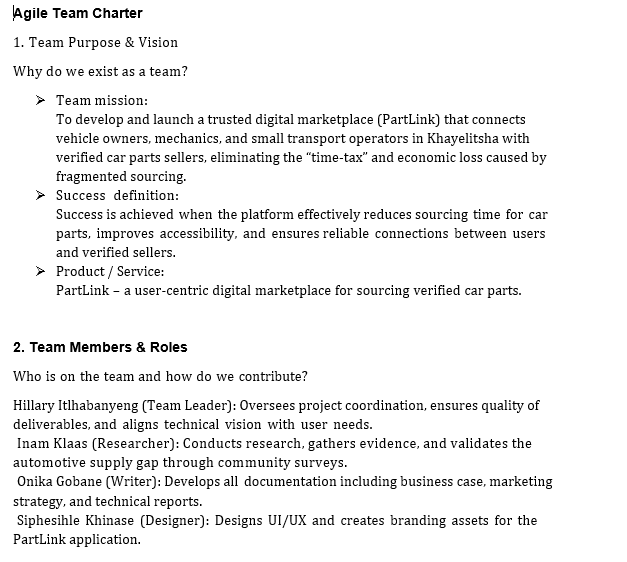
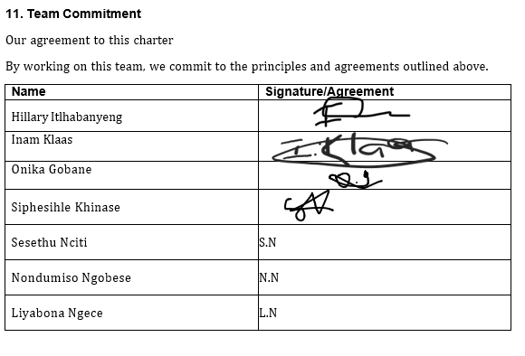
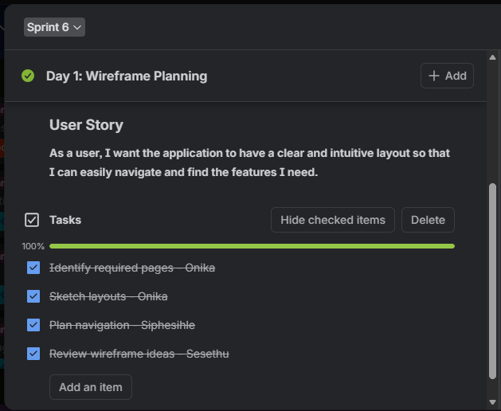
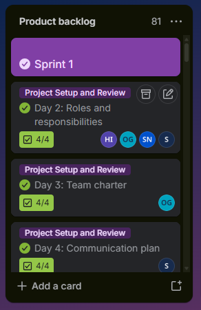
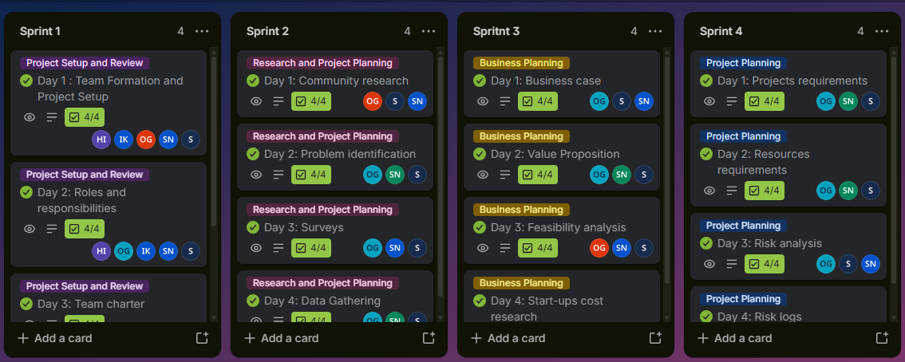
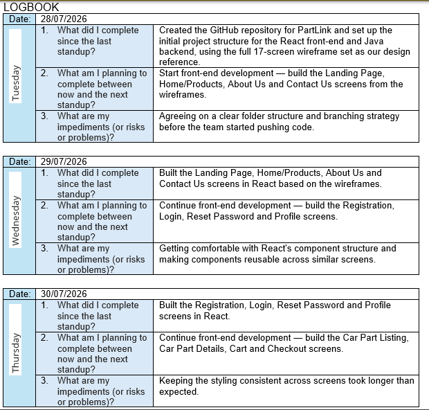

<button type="button">jump to the second semester submission</button>
# **SIPHESIHLE KHINASE**

#### **ICT STUDENT**
## **OBJECTIVE**

I am an ICT application development student seeking for a Work Integrated
Learning (WIL) placement. My primary objective is to apply my knowledge of
Java and web technologies while gaining an industrial experience and
contributing to real world software development projects. I am passinate about developing softwares that could make lives easier.

## **EDUCATION**
**Dangwana S.S.S**
- National Senior Certificate
- Jan 2022

**Cape Peninsula University of Technology**
- Higher Certificate in ICT
- Jan 2024

**Cape Peninsula University of Technology**
- Diploma in ICT
- Jan 2024 - Present

## **CONTACT**
📞 064 848 2130  
📩 <230926177@mycput.ac.za>  
🏠 Belhar 23, Cape Town, SA  
👤 <https://www.linkedin.com/in/siphesihle-khinase-25861226b/>  
🌐 <https://siphesihle2130.github.io/siphesihle-s-Portfilio-web>

## **EXPERIENCE**
### **V O L U N T E E R  E X P E R I E N C E**

**Montelo Solar | Jun 2025 – Nov 2025 | Front End Student Developer**
- Montelo is an upcoming e-commerce business that bridges the
  gap between solar suppliers, installers and customers. My role
  in this project is to design the client-side of the website while
  focusing on visually appealing and functional user interface
  and ensuring a smooth user experience.

### **A C A D E M I C E X P E R I E N C E / P R O J E C T S**

**Application Tracking System | Feb 2025 – Nov 2025 | Full – Stack Student Developer**
- ATS is a java application that was designed to help students
  search for courses that they qualify for before applying to
  minimize chances of being rejected. My role in this project was
  to design two screens in the app and combine all screens from
  other teammates into one app and connect it to the database.

## **TECHNICAL SKILLS**
- HTML
- Java
- JavaScript
- CSS
- PHP
- Phyton
- MySQL

## **REFERENCES**
**Susan Hendrics**
- Self Employed
- <Honeysuzan29@gmail.com>
- 084 577 7432

**Aphiwe Tambo**
- True Guard
- <aphiwetambo@gmail.com>
- 076 867 5632

## **CV Reflection**

### **Challenges**
One of the main challenges I faced while designing my CV using Markdown was that the CV displayed correctly on GitHub, but not on GitHub Pages.
When I viewed the CV on GitHub Pages, the formatting was incorrect. There were no proper spaces between words, and all the text appeared in the same font size, including headings. This made the CV look unstructured and unprofessional. The issue made me realise that there is a difference between how Markdown displays on GitHub and how it is displayed when deployed using GitHub Pages.

### **Tasks**
The task was to design a professional CV using Markdown on GitHub and then deploy it using GitHub Pages so that it could be accessed as a live website. I was also required to include a mock interview video as part of the CV and ensure that both the CV and the video were accessible through a single link.

### **Action**
To solve the problem, I conducted research by watching tutorial videos and visiting online resources to understand why my CV was not displaying correctly. During this process, I learned that GitHub Pages uses a different rendering system, which can affect formatting. I then created and added a config.yml file to my repository to configure the site properly. I also reviewed and corrected my Markdown formatting, ensuring that headings, spacing, and structure were correctly applied. 

### **Results**
After applying these changes, the CV was successfully displayed correctly on GitHub Pages with proper formatting, spacing, and structure. The headings appeared as expected, and the overall layout looked more professional.

# **Mock interview**

<video width="100%" controls>
  <source src="Mock interview.mp4" type="video/mp4">
  Your browser does not support the video tag.
</video>

## **Mock Interview Reflection**

### **Challenges**
One of the main challenges I faced during the mock interview was struggling to speak clearly while maintaining eye contact with the camera. I also found it difficult to remember the correct order of the questions I had selected, which affected my confidence and fluency during recording.

### **Tasks**
The task required me to select four questions from the list that was provided and record a mock interview video that was no longer than two minutes. The goal was to demonstrate my ability to answer interview questions clearly, confidently, and professionally.

### **Action**
To overcome these challenges, I practiced answering the questions in front of a mirror. This helped me become more comfortable with maintaining eye contact and improved my confidence when speaking. I also rehearsed the order of the questions multiple times so that I could remember them more easily during the recording.

### **Results**
As a result, I was able to successfully record a mock interview video within the required time limit. My confidence improved, and I was able to answer the questions more clearly and in the correct order. This exercise helped me develop better communication and presentation skills for future interviews.

## **GitHub Pages Reflection**

### **Challenges**
The main challenge I faced was adding the mock interview video to my CV using HTML within my Markdown file. After publishing the page using GitHub Pages, the video link did not display correctly, which meant the video could not be viewed on the live site.

### **Tasks**
The task was to design a CV using Markdown on GitHub, deploy it using GitHub Pages, and include a mock interview video that could be accessed from the same page.

### **Action**
To resolve the issue, I asked for assistance in the student WhatsApp group and also conducted independent research online. Through this process, I learned how to correctly link and embed video files using HTML within a Markdown document. I then updated my code and ensured that the video file path and format were correct before republishing the page.

### **Results**
After making the necessary corrections, I was able to successfully add the mock interview video to my CV and publish the page correctly. The video could be viewed and accessed through the GitHub Pages link. This experience improved my understanding of integrating multimedia content into web pages and strengthened my problem-solving skills.

# **SEMESETER 2 DELIVERABLES**
## **Agile Team Charter**
### **Evidence**
  
### **Reflection**
Our team charter set out who we were, how we would work and what we expected from each other while building PartLink, an online marketplace for buying and selling car parts. We agreed on roles, communication channels, meeting times, shared values such as respect and accountability, and how we would handle conflict. Writing it early was valuable because it turned vague good intentions into commitments we could point back to. What went well was that everyone had a say, which gave the team a sense of ownership. A challenge was that some of our rules, such as response times, were harder to keep once deadlines from other modules piled up. I learned that a charter is only useful if it is revisited, not filed away. Next time I would review it at the end of each sprint and adjust it based on what is actually working for the team.

## **User Stories and Tasks**
### **Evidence**
  
### **Reflection**
Writing user stories helped us look at PartLink through the eyes of its users rather than as a list of features. We wrote stories in the format “As a buyer or seller or stakeholder, I want [goal] so that [benefit]”, for example searching parts by make, model and year, or listing a part for sale in minutes. We then broke each story into smaller tasks such as designing the search page, building the listing form and testing it. What worked well was that stories kept us focused on user value and made the work easier to divide among team members. The difficult part was making stories small and clear enough to finish in one sprint, because some started out too big or vague. I learned the value of acceptance criteria, which gave us a shared definition of “done”. In future I would involve a real user earlier to check that our stories match actual needs.

## **Product Backlog**
### **Evidence**

### **Reflection**
The product backlog gave us one ordered list of everything PartLink might need, from the core features car part searching, listings, seller profiles, payments to nice-to-haves such as reviews and chat. Prioritising it forced us to decide what delivers the most value first, rather than building whatever seemed interesting. We used value versus effort method to rank items, and the highest-value items went to the top. What went well was seeing the whole product in one place and knowing it could change as we learned more. The challenge was disagreement about priorities, since each of us valued different features. I learned that prioritization should be based on user value and risk, not personal preference. Next time I would estimate items earlier and refine the backlog regularly so that the top items are always clear and ready to start.

## **Sprint Backlog**
### **Evidence**

### **Reflection**
The sprint backlog showed what we committed to in each sprint: the stories selected from the product backlog, broken into tasks with owners and a status of To Do, In Progress or Done. Planning the sprint made us realistic about how much we could achieve in the time available and who was responsible for what. What worked well was that the board made progress visible, so blockers were noticed quickly and the daily check-ins stayed short and useful. A challenge was over-committing in the first sprint, so some tasks carried over, and tasks were sometimes underestimated. From this I learned that velocity improves with experience, and that it is better to commit to less and finish it properly. In future sprints I would use our previous sprint’s results to plan more accurately and keep a small buffer for unexpected work.

## **Agile Logbook**
### **Evidence**

### **Reflection**
The logbook was our record of what we did each sprint: meetings, decisions, task progress, problems and lessons learned. Keeping it up to date helped me see how the project developed and made it easier to explain our decisions and individual contributions. What went well was that it gave us evidence of progress and made our retrospectives more honest, because we could look back at what actually happened rather than relying on memory. The main challenge was discipline: it was easy to let entries pile up and then write them from memory. I learned that short, regular entries are far more useful than long ones written late. Going forward I would update the log straight after each meeting, and I would use it to track the actions from retrospectives to check we really act on what we learn.
